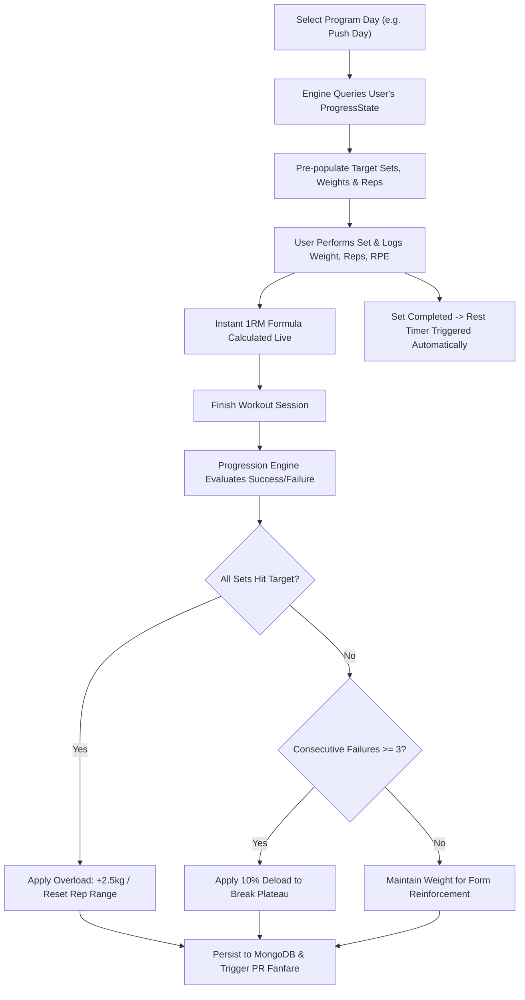
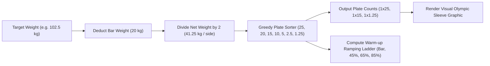
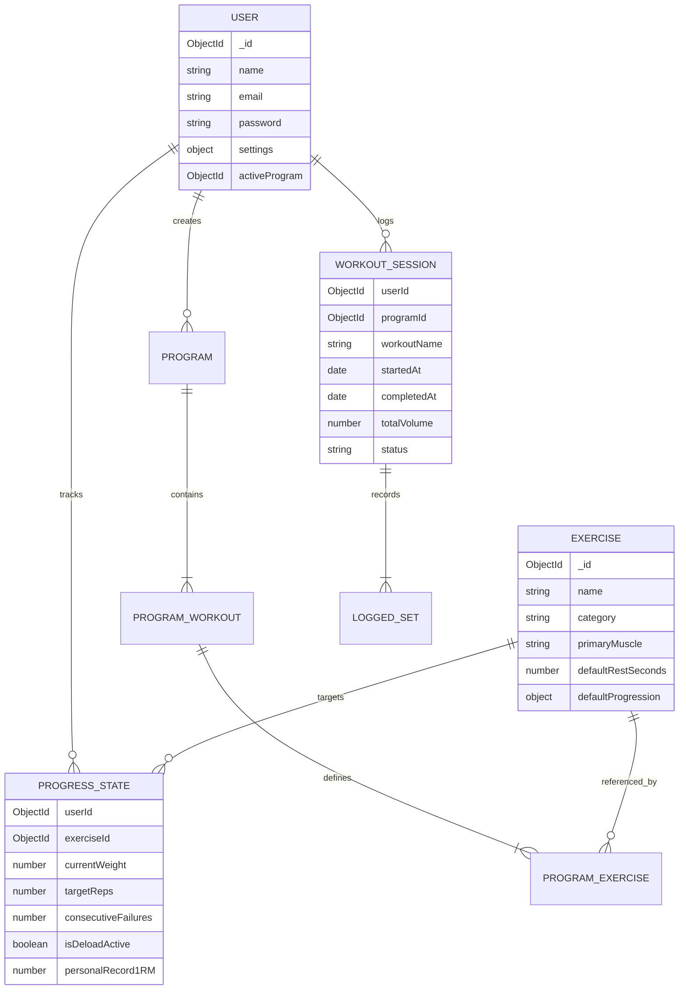

# RepTrack🏋️ — Smart Workout Planner & Progressive Overload Engine

> A full-stack MERN software application designed for strength lifters, athletes, and coaches. Automates scientific progressive-overload protocols, calculates real-time estimated One-Rep-Max (1RM) using 6 peer-reviewed equations, renders visual barbell plate loading mathematics, and tracks long-term hypertrophy volume.

---

## 🎥 Video Walkthrough & User Guide

> **This video explains the project architecture and serves as a comprehensive guide on how to use RepTrack.**
>
> 📺 **Watch Full Video Guide (Google Drive):** [https://drive.google.com/file/d/1v7T1LJeObpH1prl_URr0Phq3i5k_Zepv/view?usp=drivesdk](https://drive.google.com/file/d/1v7T1LJeObpH1prl_URr0Phq3i5k_Zepv/view?usp=drivesdk)

[](https://drive.google.com/file/d/1v7T1LJeObpH1prl_URr0Phq3i5k_Zepv/view?usp=drivesdk)

*The video provides an end-to-end explanation and user guide covering:*
- **System Architecture & Tech Stack:** React SPA, Express REST controllers, MongoDB Mongoose schema models.
- **One-Click Demo Evaluator Access:** Instant login with pre-populated PRs and 1RM history.
- **Active Workout Logger:** Real-time 1RM calculations across 6 peer-reviewed equations.
- **Barbell Plate Visualizer:** Color-coded Olympic sleeve plate loading and warmup ladders.
- **Rest Interval Queue:** Real-time timer with active-training seconds credited to session volume.
- **Scientific Progressive Overload:** Automated +2.5kg weight progression on target rep completion and 10% deloading on plateau detection.

---

## ⚡ Quick Access & Demo Credentials

- **Live Production Application:** [https://reptrack-pi.vercel.app](https://reptrack-pi.vercel.app)
- **Production Backend API:** [https://reptrack-pf4j.onrender.com/api/health](https://reptrack-pf4j.onrender.com/api/health)
- **Video Walkthrough & Guide:** [https://drive.google.com/file/d/1v7T1LJeObpH1prl_URr0Phq3i5k_Zepv/view?usp=drivesdk](https://drive.google.com/file/d/1v7T1LJeObpH1prl_URr0Phq3i5k_Zepv/view?usp=drivesdk)

### 🔑 Demo Credentials (Instant 1-Click Login)
To test RepTrack with rich pre-populated analytics, PRs, and workout history:
1. Open **[https://reptrack-pi.vercel.app/login](https://reptrack-pi.vercel.app/login)** (or `http://localhost:5173/login`)
2. Click the **`⚡ One-Click Evaluator Demo Login`** button (or sign in manually):
   - **Email:** `demo@reptrack.com`
   - **Password:** `password123`
3. You will immediately see:
   - **Interactive 1RM progression charts** across Bench Press, Squat, and Deadlift
   - **Volume distribution** across Chest, Back, Quads, and Shoulders
   - **Recent Milestone PRs**
   - Active workouts with real-time rest timers and barbell plate calculations!

---

## 📖 Table of Contents

- [🎥 Video Walkthrough & User Guide](#-video-walkthrough--user-guide)
- [⚡ Quick Access & Demo Credentials](#-quick-access--demo-credentials)
1. [Problem Statement](#1-problem-statement)
2. [Target Users](#2-target-users)
3. [Solution & Product Philosophy](#3-solution--product-philosophy)
4. [Technology Stack](#4-technology-stack)
5. [Core Architectural Workflows](#5-core-architectural-workflows)
6. [Engineering Depth & Application Logic](#6-engineering-depth--application-logic)
   - [Automated Progressive Overload Engine](#automated-progressive-overload-engine)
   - [Sports Science 1RM Formula Comparisons](#sports-science-1rm-formula-comparisons)
   - [Barbell Plate Loading Mathematics](#barbell-plate-loading-mathematics)
7. [System Architecture & Data Model](#7-system-architecture--data-model)
8. [Local Development & Setup Guide](#8-local-development--setup-guide)
9. [Environment Variables](#9-environment-variables)
10. [Demo Credentials & Quick Evaluation](#10-demo-credentials--quick-evaluation)
11. [Evaluation Rubric Checklist](#11-evaluation-rubric-checklist)

---

## 1. Problem Statement

Progressive overload is the fundamental physiological principle of resistance training: to continue gaining muscle tissue and neuromuscular strength, the body must experience gradually increasing stimulus over time.

However, 90% of lifters encounter chronic plateaus because:
1. **Subjective Guesswork:** Lifters guess how much weight to put on the bar rather than tracking actual sets, reps, and Rate of Perceived Exertion (RPE).
2. **Inconsistent Progression Rules:** Lifters mix linear jumps, random rep targets, or jump weight too quickly, leading to failed sets, excessive fatigue, or injury.
3. **Plate Loading Friction:** In a busy gym environment, calculating Olympic barbell plate configurations (e.g., 82.5kg on a 20kg bar with 25kg, 20kg, 10kg, 5kg, 2.5kg, 1.25kg plates) causes hesitation and mistakes.
4. **Lack of Objective Strength Tracking:** Testing true 1-rep maximums is dangerous and fatiguing; lifters lack real-time estimated 1RM calculations across their daily working rep ranges (3–12 reps).

---

## 2. Target Users

- **Novice to Intermediate Lifters:** Individuals running proven routines (e.g., Push-Pull-Legs, Starting Strength 5x5, Upper/Lower) who need precise guidance on what weight to lift each session.
- **Strength & Powerbuilding Athletes:** Lifters monitoring 1RM trajectory, RPE fatigue levels, and barbell warmup ladders.
- **Fitness Coaches & Programmers:** Users who need customizable routines with strict overload increments, failure thresholds, and automated deload recovery triggers.

---

## 3. Solution & Product Philosophy

**RepTrack** transforms workout tracking from passive note-taking into an **active progressive overload engine**:
- **Automated Target Generation:** At the start of every workout, RepTrack inspects past performance and pre-populates target loads and reps based on the programmed rule (Linear, Double Progression, or RPE-based).
- **Auto-Progression & Plateau Deloading:** When a lifter hits all target reps across their sets, RepTrack automatically increases working load for the next session. If the lifter fails target reps for 3 consecutive sessions, the engine detects a plateau and automatically prescribes a 10% deload to rebuild momentum.
- **Real-Time 1RM Formulation:** During set entry, RepTrack calculates instantaneous estimated 1RM across 6 validated equations (Epley, Brzycki, Lombardi, Mayhew, O'Conner, Wathen).
- **Interactive Barbell Plate Visualizer:** Generates exact color-coded Olympic plate stacks per sleeve (Red 25kg, Blue 20kg, Yellow 15kg, Green 10kg, White 5kg, Black 2.5kg, Silver 1.25kg) and calculates ramp-up warmup ladders.

---

## 4. Technology Stack

As strictly required, this project is built entirely with:

| Layer | Technologies Used | Description |
|---|---|---|
| **Frontend Framework** | **React (Vite)** | High-speed single-page application bundling |
| **Language & Markup** | **JavaScript (ES6+)**, **HTML5**, **CSS3** | Modern vanilla styling with custom dark athletic theme |
| **Client Routing** | **React Router (`react-router-dom` v6)** | Declarative client-side routing & protected route guards |
| **API Client** | **Axios** | HTTP client with automatic Bearer JWT injection |
| **Backend Runtime** | **Node.js (v20+)** | High-performance asynchronous runtime |
| **Web Server** | **Express.js (v4)** | Modular REST API with controllers and middleware |
| **Database & ODM** | **MongoDB Atlas / Mongoose (v8)** | NoSQL document persistence with strict schema modeling |
| **Security & Auth** | **bcryptjs**, **jsonwebtoken (JWT)** | Salted password hashing (10 rounds) & signed bearer tokens |
| **Configuration & CORS**| **dotenv**, **cors** | Multi-environment secrets and cross-origin resource sharing |

---

## 5. Core Architectural Workflows

### Workflow 1: Active Workout Session & Automatic Progression



### Workflow 2: Barbell Plate Calculation & Warmup Ladder



---

## 6. Engineering Depth & Application Logic

### Automated Progressive Overload Engine

RepTrack implements 3 distinct progression rule strategies in `server/utils/progressionEngine.js` and `client/src/utils/progressionEngine.js`:

1. **Linear Progression (Compound Barbell Focus):**
   - Ideal for beginner-to-intermediate compound strength (Squat, Bench, Deadlift, Overhead Press).
   - Condition: If `sets.every(s => s.actualReps >= s.targetReps)`, increment load by `weightIncrementKg` (default 2.5kg).
   - Plateau Protection: If failures reach `failureThreshold` (default 3), the engine activates a `deloadPercentage` (10% load reduction) to dissipate systemic neural fatigue and enable a new progression cycle.

2. **Double Progression (Rep Range Accessory Focus):**
   - Ideal for hypertrophy accessories (Dumbbell Presses, Lateral Raises, Curls, Lat Pulldowns).
   - Works across a rep range (e.g., 8–12 reps).
   - If user hits 12 reps on all sets, the weight increases and target reps drop back to 8 reps.
   - If user achieves between 8 and 11 reps, the weight remains unchanged and target reps increment by 1.

3. **RPE-Regulated Progression:**
   - Evaluates Rate of Perceived Exertion (RPE 6–10).
   - If logged average RPE is $\ge 1.0$ point below target RPE (lift moved easily), an immediate micro-increment is triggered.

### Sports Science 1RM Formula Comparisons

Rather than relying on a single naive formula, RepTrack calculates estimated 1RM using 6 published sports science equations:

| Formula | Mathematical Equation | Best Application |
|---|---|---|
| **Epley (1985)** | $1\text{RM} = w \cdot (1 + \frac{r}{30})$ | Standard barbell compound lifts (3–10 reps) |
| **Brzycki (1993)** | $1\text{RM} = w \cdot \frac{36}{37 - r}$ | Lower body heavy resistance (reps $< 10$) |
| **Lombardi (1989)** | $1\text{RM} = w \cdot r^{0.10}$ | Conservative upper body estimates |
| **Mayhew et al. (1992)** | $1\text{RM} = \frac{100 \cdot w}{52.2 + 41.9 \cdot e^{-0.055 \cdot r}}$ | General resistance training |
| **O'Conner et al. (1989)** | $1\text{RM} = w \cdot (1 + 0.025 \cdot r)$ | Higher rep sets (8–15 reps) |
| **Wathen (1994)** | $1\text{RM} = \frac{100 \cdot w}{48.8 + 53.8 \cdot e^{-0.075 \cdot r}}$ | Explosive athletic movements |
| **Scientific Average** | $\frac{1}{6} \sum (\text{Formulas})$ | Blended consensus score |

---

## 7. System Architecture & Data Model

### Entity-Relationship Diagram



---

## 8. Local Development & Setup Guide

### Prerequisites
- **Node.js** (v18.0.0 or higher)
- **npm** (v9.0.0 or higher)
- **MongoDB** (Local instance running at `mongodb://127.0.0.1:27017` OR a free cloud cluster on [MongoDB Atlas](https://www.mongodb.com/cloud/atlas))

---

### Step 1: Clone Repository & Install Dependencies

```bash
# Clone the repository
git clone https://github.com/your-username/RepTrack.git
cd RepTrack

# Install server dependencies
npm install --prefix server

# Install client dependencies
npm install --prefix client
```

---

### Step 2: Configure Environment Variables

The server includes a pre-configured `.env` file pointing to local MongoDB. To use MongoDB Atlas, edit `server/.env`:

```env
PORT=5000
NODE_ENV=development
MONGO_URI=mongodb+srv://<username>:<password>@cluster0.mongodb.net/reptrack?retryWrites=true&w=majority
JWT_SECRET=reptrack_super_secure_jwt_secret_key_2026_dev
CLIENT_URL=http://localhost:5173
```

---

### Step 3: Seed Default Data (Optional CLI step)

```bash
# Seed default exercises, programs, and demo user with 11 realistic past workouts:
npm run seed --prefix server
```
*(Note: If you run without manual seeding, the server automatically seeds the database on first startup!)*

---

### Step 4: Run Application

Open two terminal windows:

**Terminal 1 (Backend API):**
```bash
npm run dev --prefix server
# Server starts on http://localhost:5000
```

**Terminal 2 (Frontend Client):**
```bash
npm run dev --prefix client
# Client starts on http://localhost:5173
```

Navigate to **`http://localhost:5173`** in your browser.

---

## 9. Environment Variables

| Variable | Environment | Default Value | Description |
|---|---|---|---|
| `PORT` | Server | `5000` | Port on which the Express server listens |
| `NODE_ENV` | Server | `development` | Node environment (`development` or `production`) |
| `MONGO_URI` | Server | `mongodb://127.0.0.1:27017/reptrack` | MongoDB connection URI (Atlas or local) |
| `JWT_SECRET` | Server | `reptrack_super_secure_jwt_secret_key_2026_dev` | Secret key used to sign and verify JWT tokens |
| `CLIENT_URL` | Server | `http://localhost:5173` | Frontend origin permitted for CORS requests |

---

## 10. Demo Credentials & Quick Evaluation

To test RepTrack with rich pre-populated analytics, PRs, and workout history:

1. Open **[https://reptrack-pi.vercel.app/login](https://reptrack-pi.vercel.app/login)** (or `http://localhost:5173/login` for local development)
2. Click the **`⚡ One-Click Evaluator Demo Login`** button (or sign in manually):
   - **Email:** `demo@reptrack.com`
   - **Password:** `password123`
3. You will immediately see:
   - **Interactive 1RM progression charts** across Bench Press, Squat, and Deadlift
   - **Volume distribution** across Chest, Back, Quads, and Shoulders
   - **Recent Milestone PRs**
   - Active workouts with real-time rest timers and barbell plate calculations!

---

## 11. Evaluation Rubric Checklist

- [x] **Complete Software Product:** Functional full-stack MERN application (no static mockup, no tutorial clone).
- [x] **Meaningful Application Logic:** Automated progressive overload engine, 1RM sports-science formulas, plate loading algorithms.
- [x] **Authentication & Authorization:** Secure signup, login, JWT token issuance, bcryptjs password hashing (10 rounds), and protected route guards.
- [x] **Data Persistence:** Complete MongoDB schema models for Users, Exercises, Programs, Sessions, and Progress States via Mongoose.
- [x] **Error Handling:** Graceful handling of network disconnects, invalid credentials, missing exercises, and input validation.
- [x] **Clean Modular Architecture:** Strict separation of controllers, models, routes, context providers, and calculation services.
- [x] **Security:** Passwords hashed with bcryptjs, secrets kept in environment variables (`.env` ignored in Git).
- [x] **Evaluator Friendly:** One-click demo credentials and seed scripts for instantaneous grading.
